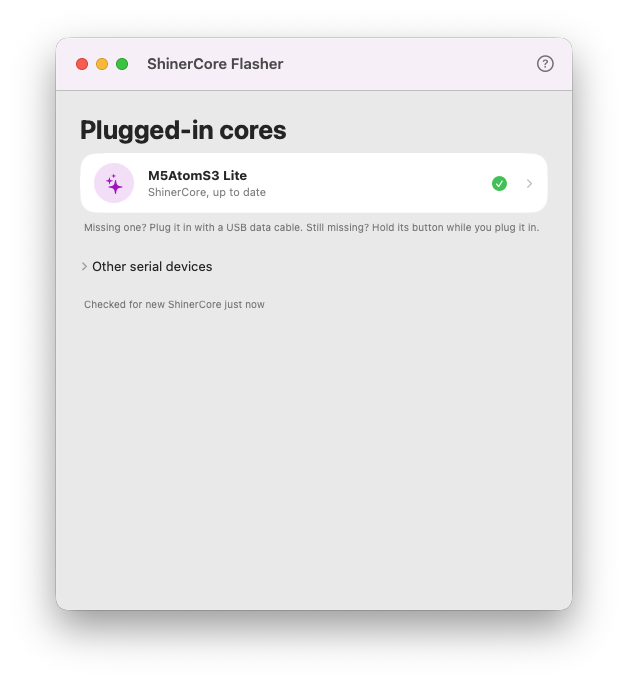

# ShinerCore Flasher

A Mac app that puts the latest ShinerCore firmware on a core, keeping its presets,
wiring and settings.



## Flashing a core

1. Download [ShinerCoreFlasher.zip](https://github.com/nevyn/shinercore/releases/latest/download/ShinerCoreFlasher.zip),
   open it, and move **ShinerCore Flasher** to Applications.
2. Open it, and plug in the core with a USB data cable. (Some cables only charge; if the
   core doesn't show up, try another.)
3. Click the core. The flasher tells you what's on it; checking restarts the core, so its
   lights go dark for a moment.
4. If it asks which model the core is, pick the one printed on the case.
5. Click **Install ShinerCore** (or **Update**), and wait until it says it's installed.

New to ShinerCore? The window explains what you need when no core is plugged in, and
**Help > How ShinerCore Works** shows it again.

The flasher keeps the latest firmware for offline use, so it works at a festival without
signal once it has been opened with internet.

## Developing

Requires Xcode 16 or later (Swift 6 toolchain), on an Apple Silicon or Intel Mac.

```
swift test
scripts/build-app.sh [VERSION]     # dist/ShinerCoreFlasher.app, signed with the Developer ID
./release.sh VERSION               # notarizes; prints the gh command that publishes it

FLASHER_SHOTS=1 swift test --filter Shots    # UI states, light and dark, to /tmp/flasher-shots
FLASHER_HW_PORT=/dev/cu.usbmodemXXXX swift test --filter Hardware
                                   # flashes /tmp/shinerfw-dist onto a real AtomS3 with the built app's esptool
swift scripts/make-icon.swift app/AppIcon.icns   # redraws the icon
```

The app logs each identification and every esptool failure to the unified log:
`log stream --predicate 'subsystem == "dev.nevyn.ShinerCoreFlasher"'`.

Launch arguments: `--firmware-dir DIR` flashes the firmware build that `ci/build-firmware.sh DIR`
wrote instead of using GitHub; `--background-window` keeps the window behind others without
taking focus.

The release layout, manifest and fingerprint are in
[../docs/firmware-builds.md](../docs/firmware-builds.md).

The app bundles Espressif's standalone [esptool](https://github.com/espressif/esptool)
v5.6.0 (`esptool-v5.6.0-macos-{arm64,amd64}.tar.gz` from its GitHub releases), which is
licensed under GPLv2; its license ships in `Contents/Resources/esptool/LICENSE`.
